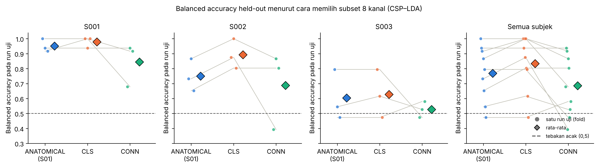

# Same Channels, Different Insights?

**Comparing EEG Channel Selection for Motor Imagery Classification and Functional Connectivity**

**Bintang Adhitya Kuncoro Putra**  
**NIM 23/518604/TK/57118**  
Proyek UTS individu · Teknik Biomedis

## Tentang proyek

Apakah delapan kanal EEG yang dipilih untuk klasifikasi *motor imagery* juga mampu membedakan pola konektivitas fungsional antara imajinasi gerakan kedua kepalan tangan dan kedua kaki?

Studi eksploratif ini menggunakan data [PhysioNet EEG Motor Movement/Imagery Database](https://physionet.org/content/eegmmidb/1.0.0/) dari tiga subjek (S001–S003), masing-masing dengan run 6, 10, dan 14. Notebook membandingkan tiga cara memilih delapan kanal dari sepuluh subset kandidat.

| Pendekatan | Kriteria pemilihan kanal |
| --- | --- |
| Anatomis | Subset tetap berdasarkan lokasi elektroda |
| CLS | *Balanced accuracy* tertinggi dalam validasi internal dengan CSP–LDA |
| CONN | Skor diskriminasi konektivitas (CDS) tertinggi pada data latih, dihitung dari perbedaan konektivitas antarkelas menggunakan *debiased squared wPLI* pada pita 8–12 Hz |

Setiap subjek dievaluasi dengan skema *leave-one-run-out*. Dua run dipakai untuk pemilihan subset dan pelatihan, lalu satu run disisihkan untuk evaluasi. Proses ini menghasilkan sembilan fold uji.

## Hasil utama

| Pendekatan | Rata-rata *balanced accuracy* uji | Rata-rata CDS uji |
| --- | ---: | ---: |
| Anatomis | 76,9% | 0,3324 |
| CLS | **83,3%** | **0,3404** |
| CONN | 68,6% | 0,3215 |

CLS memperoleh rata-rata tertinggi pada kedua metrik, sementara CLS dan CONN memilih subset yang sama hanya pada 2 dari 9 fold. Banyak skor konektivitas berada dekat tingkat yang diperoleh ketika label kelas diacak. Dengan tiga subjek dan evaluasi antar-run dalam subjek, hasil ini bersifat deskriptif dan belum menguji generalisasi ke subjek baru.



## Menjalankan notebook

1. Unduh atau kloning repo, lalu buka terminal di folder proyek. Eksperimen terdokumentasi menggunakan Python 3.13.16.
2. Instal dependensi dan buka notebook.

   ```bash
   python -m pip install -r requirements.txt
   jupyter notebook Same_Channels_Different_Insights.ipynb
   ```

3. Jalankan semua sel dari atas ke bawah. Notebook mengunduh rekaman EEG saat pertama dijalankan dan menyimpan tabel serta grafik di `outputs/`. Hasil yang sudah tersimpan juga dapat dilihat dengan membuka notebook langsung di GitHub.

## Isi repositori

| File atau folder | Isi |
| --- | --- |
| [Notebook eksperimen](Same_Channels_Different_Insights.ipynb) | Akuisisi data, prapemrosesan, seleksi kanal, evaluasi, dan visualisasi |
| [Ringkasan hasil](RESULTS_SUMMARY.md) | Hasil per subjek, audit permutasi, dan keterbatasan |
| [Landasan teori](THEORETICAL_FRAMEWORK.md), [tinjauan pustaka](LITERATURE_REVIEW.md), dan [bibliografi](references.bib) | Konsep EEG, metode, dan sumber ilmiah |
| [Outputs](outputs/) | Tabel hasil, log eksperimen, dan grafik |
